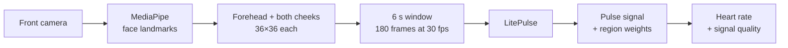

# LitePulse

[](https://github.com/OWNER/REPO/actions/workflows/pages.yml)

**Contactless heart-rate measurement from a face video, with a 51k-parameter rPPG network that
runs on a phone or in the browser.**

Demo applications for the GEMASTIK 2026 paper *LitePulse: Jaringan rPPG Ringan dengan Knowledge
Distillation dan Adaptive ROI Fusion untuk Mengurangi Disparitas Warna Kulit*.

| | |
|---|---|
| 🌐 **Try it in the browser** | https://OWNER.github.io/REPO/ |
| 📱 **Android app** | [Download the latest APK](https://github.com/OWNER/REPO/releases/latest) |
| 🧪 **Training code** | [KevinFu12/LitePulse](https://github.com/KevinFu12/LitePulse) (built on rPPG-Toolbox) |

> [!NOTE]
> LitePulse is a research demo, not a medical device. Don't use its readings for diagnosis.

## Highlights

- **Tiny.** 51,069 parameters (0.05 M) and a 231 KB checkpoint, over 140× smaller than
  PhysFormer.
- **Generalises.** Trained only on UBFC-rPPG, it reaches 1.82 bpm MAE on PURE, the lowest of
  the eight models compared in the paper.
- **Fairer across skin tones.** Multi-ROI learning with Adaptive Physiological ROI Fusion (APRF)
  narrows the error gap between Fitzpatrick skin-type groups by 33% on Mini-MMPD.
- **Private.** Both apps process the video on the device. Nothing is uploaded.

## How it works



- **Regions of interest.** The forehead and both cheeks are cut out with polygon masks from
  MediaPipe's 478 face landmarks, resized to 36×36, and normalised (DiffNormalized +
  Standardized, 6 channels per region).
- **Shared ROI encoder.** One small encoder (depthwise temporal and lightweight spatial
  convolutions) processes each region.
- **APRF.** For every frame, softmax weights decide how much to trust each region, so the model
  can lean on whichever region has the clearest pulse.
- **Pulse Spectral Attention.** Channels are gated by how much of their energy falls in the
  heart-rate band (0.7–2.5 Hz).
- **Signal-level knowledge distillation.** During training, a large teacher model's predicted
  pulse guides the small student. Only the student ships in the apps.
- **Heart rate.** The predicted pulse is detrended and band-pass filtered (0.75–2.5 Hz). The
  FFT peak gives bpm, and peak-to-noise and band energy give a quality score.

## Results

From the paper. The model was trained on UBFC-rPPG; PURE and Mini-MMPD are unseen datasets.

| Test set | MAE (bpm) | RMSE | MAPE (%) | ρ | SNR |
|---|---:|---:|---:|---:|---:|
| UBFC-rPPG (same dataset) | 1.62 | 2.93 | 0.93 | 0.976 | 1.60 |
| PURE | 1.82 | 9.29 | 1.54 | 0.949 | 3.26 |
| Mini-MMPD | 11.62 | 19.39 | 13.89 | 0.365 | −5.49 |

On Mini-MMPD, the hardest set (varied lighting, motion and skin tones), LitePulse has the best
ρ and SNR of all compared models. Both training ideas pay off on unseen data: on PURE,
multi-ROI lowers MAE from 5.06 to 1.82 bpm and knowledge distillation lowers it from 7.78 to
1.82 bpm.

**Efficiency** (one 180-frame window, Tesla T4 GPU and a 2-vCPU Xeon):

| Model | Parameters | GPU (ms) | CPU (ms) |
|---|---:|---:|---:|
| PhysFormer | 7.38 M | 51.59 | 517.07 |
| LiteSyncNet | 2.84 M | 14.18 | 423.96 |
| IBVPNet | 1.43 M | 12.79 | 395.74 |
| **LitePulse** | **0.05 M** | **8.68** | **374.71** |

**Skin tone** (Mini-MMPD): adding multi-ROI with APRF lowered the MAE for Fitzpatrick VI from
24.01 to 15.75 bpm. It also cut the gap between the best and worst skin-type groups from 14.19
to 9.48 bpm. With only 6 Fitzpatrick VI subjects, the per-group result is indicative rather
than statistically significant (p = 0.128).

## Repository layout

| Folder | Contents |
|---|---|
| [`android/`](android) | Android app: Kotlin, Jetpack Compose, CameraX, MediaPipe, PyTorch Lite |
| [`web/`](web) | Browser version: MediaPipe web, ONNX Runtime Web, no build step |
| [`model/`](model) | Network definition, trained checkpoint, `.ptl` and `.onnx` exporters |
| [`.github/workflows/`](.github/workflows) | Publishes `web/` to GitHub Pages |

## Getting started

### Android app

Needs Android 8.0+ on a 64-bit (arm64-v8a) phone. Open the `android/` folder in Android
Studio, or build from the command line (use `gradlew.bat` on Windows):

```bash
cd android
./gradlew assembleDebug
adb install -r app/build/outputs/apk/debug/app-debug.apk
```

`./gradlew assembleRelease` builds the R8-shrunk release APK (about 25 MB, signed with the
debug key for sideloading). Logs: `adb logcat -s LitePulse LitePulseTiming`.

### Browser version

```bash
python web/verify/serve.py
```

Open http://localhost:8765 (add `?debug` for signal and timing details). The camera needs
`localhost` or HTTPS. The JavaScript port of the preprocessing and heart-rate maths is checked
against the Python training code; see [`web/README.md`](web/README.md).

### Model

`model/` holds `LitePulse.py`, the checkpoint in `pth_model/`, and two exporters. Run them
from inside `model/`. Each one compares the exported model with the PyTorch checkpoint and
stops if they differ.

| Script | Output | Copy to |
|---|---|---|
| `litepulse_ptl_generator.py` | `litepulse.ptl` (PyTorch Lite, 257 KB) | `android/app/src/main/assets/` |
| `litepulse_onnx_generator.py` | `litepulse.onnx` (379 KB) | `web/models/` |

## Publishing

- **Website.** Every push to `main` that changes `web/` redeploys GitHub Pages. One-time setup:
  Settings → Pages → Source: **GitHub Actions**.
- **APK.** The website's download button always points to `LitePulse.apk` in the newest
  release:
  1. `cd android` and `./gradlew assembleRelease`
  2. Rename `app/build/outputs/apk/release/app-release.apk` to `LitePulse.apk`.
  3. On GitHub: Releases → Draft a new release → tag (for example `v1.0`) → attach
     `LitePulse.apk` → Publish.

## Datasets and acknowledgements

Training used [UBFC-rPPG](https://sites.google.com/view/ybenezeth/ubfcrppg); evaluation used
[PURE](https://www.tu-ilmenau.de/en/university/departments/department-of-computer-science-and-automation/profile/institutes-and-groups/institute-of-computer-and-systems-engineering/group-for-neuroinformatics-and-cognitive-robotics/data-sets-code/pulse-rate-detection-dataset-pure)
and Mini-MMPD, a subset of [MMPD](https://github.com/McJackTang/MMPD_rPPG_dataset). The
datasets aren't included here; request access from their providers.

Built with [rPPG-Toolbox](https://github.com/ubicomplab/rPPG-Toolbox),
[MediaPipe](https://ai.google.dev/edge/mediapipe), [PyTorch](https://pytorch.org) and
[ONNX Runtime](https://onnxruntime.ai).

## Team

Kevin Fujianto (corresponding author), Niko Sutiono, Fahimsyach Lokanta and Anderies.
Computer Science Department, School of Computer Science, Bina Nusantara University, Jakarta.
