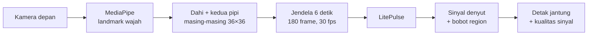

# LitePulse

[](https://github.com/NS2006/litepulse-app/actions/workflows/pages.yml)

**Pengukuran detak jantung tanpa sentuhan dari video wajah, menggunakan jaringan rPPG berukuran
sekitar 51 ribu parameter yang berjalan langsung di ponsel maupun browser.**

Aplikasi demo untuk makalah GEMASTIK 2026 *LitePulse: Jaringan rPPG Ringan dengan Knowledge
Distillation dan Adaptive ROI Fusion untuk Mengurangi Disparitas Warna Kulit*.

| | |
|---|---|
| 📱 **Aplikasi Android (versi utama)** | [Unduh APK terbaru](https://github.com/NS2006/litepulse-app/releases/latest) |
| 🌐 **Demo di browser** | https://ns2006.github.io/litepulse-app/ |
| 🧪 **Kode pelatihan** | [KevinFu12/LitePulse](https://github.com/KevinFu12/LitePulse) (berbasis rPPG-Toolbox) |

LitePulse dirancang sebagai aplikasi Android. Versi browser menjalankan pipeline yang sama dan
disediakan sebagai demo agar LitePulse mudah dicoba tanpa instalasi.

> [!NOTE]
> LitePulse adalah demo penelitian, bukan alat medis. Jangan gunakan hasil pengukurannya untuk
> diagnosis.

## Keunggulan

- **Sangat ringan.** Hanya 0.05 juta parameter dengan checkpoint 231 KB, lebih dari 140× lebih
  kecil daripada PhysFormer.
- **Generalisasi baik.** Meskipun hanya dilatih pada UBFC-rPPG, LitePulse mencapai MAE 1.82 bpm
  pada PURE, terendah di antara delapan model yang dibandingkan dalam makalah.
- **Lebih adil lintas warna kulit.** Multi-ROI learning dengan Adaptive Physiological ROI Fusion
  (APRF) mempersempit selisih error antar kelompok warna kulit Fitzpatrick sebesar 33% pada
  Mini-MMPD.
- **Menjaga privasi.** Kedua aplikasi memproses video langsung di perangkat. Tidak ada video
  yang diunggah.

## Cara kerja



- **Region of interest (ROI).** Dahi dan kedua pipi dipotong dengan masker poligon dari 478
  landmark wajah MediaPipe, diubah ukurannya menjadi 36×36, lalu dinormalisasi (DiffNormalized +
  Standardized, 6 kanal per region).
- **Shared ROI encoder.** Satu encoder kecil (depthwise temporal convolution dan lightweight
  spatial convolution) memproses setiap region.
- **APRF.** Pada setiap frame, bobot softmax menentukan seberapa besar setiap region dipercaya,
  sehingga model dapat mengandalkan region dengan sinyal denyut paling jelas.
- **Pulse Spectral Attention.** Setiap kanal diberi bobot berdasarkan porsi energinya pada pita
  frekuensi detak jantung (0.7–2.5 Hz).
- **Signal-level Knowledge Distillation.** Saat pelatihan, sinyal denyut hasil prediksi model
  teacher yang besar membimbing model student yang kecil. Hanya model student yang dipakai di
  aplikasi.
- **Detak jantung.** Sinyal denyut hasil prediksi di-detrend dan difilter band-pass
  (0.75–2.5 Hz). Puncak FFT menghasilkan nilai bpm, sedangkan rasio puncak terhadap noise dan
  energi pita menghasilkan skor kualitas sinyal.

## Hasil

Diambil dari makalah. Model dilatih pada UBFC-rPPG, sedangkan PURE dan Mini-MMPD adalah dataset
yang tidak digunakan saat pelatihan (cross-dataset).

| Set pengujian | MAE (bpm) | RMSE | MAPE (%) | ρ | SNR |
|---|---:|---:|---:|---:|---:|
| UBFC-rPPG (dataset yang sama) | 1.62 | 2.93 | 0.93 | 0.976 | 1.60 |
| PURE | 1.82 | 9.29 | 1.54 | 0.949 | 3.26 |
| Mini-MMPD | 11.62 | 19.39 | 13.89 | 0.365 | −5.49 |

Pada Mini-MMPD, set pengujian paling menantang (variasi pencahayaan, gerakan, dan warna kulit),
LitePulse memperoleh ρ dan SNR terbaik di antara seluruh model pembanding. Kedua strategi
pelatihan terbukti bermanfaat pada data baru: pada PURE, multi-ROI menurunkan MAE dari 5.06
menjadi 1.82 bpm, dan knowledge distillation menurunkannya dari 7.78 menjadi 1.82 bpm.

**Efisiensi** (satu jendela 180 frame, GPU Tesla T4 dan CPU Xeon 2 vCPU):

| Model | Parameter | GPU (ms) | CPU (ms) |
|---|---:|---:|---:|
| PhysFormer | 7.38 M | 51.59 | 517.07 |
| LiteSyncNet | 2.84 M | 14.18 | 423.96 |
| IBVPNet | 1.43 M | 12.79 | 395.74 |
| **LitePulse** | **0.05 M** | **8.68** | **374.71** |

**Warna kulit** (Mini-MMPD): penambahan multi-ROI dengan APRF menurunkan MAE kelompok
Fitzpatrick VI dari 24.01 menjadi 15.75 bpm, serta mempersempit selisih antara kelompok warna
kulit terbaik dan terburuk dari 14.19 menjadi 9.48 bpm. Karena kelompok Fitzpatrick VI hanya
terdiri dari 6 subjek, hasil per kelompok ini bersifat indikatif dan belum signifikan secara
statistik (p = 0.128).

## Struktur repositori

| Folder | Isi |
|---|---|
| [`android/`](android) | Aplikasi Android (versi utama): Kotlin, Jetpack Compose, CameraX, MediaPipe, PyTorch Lite |
| [`web/`](web) | Demo di browser: MediaPipe web, ONNX Runtime Web, tanpa proses build |
| [`model/`](model) | Definisi jaringan, checkpoint hasil pelatihan, serta exporter `.ptl` dan `.onnx` |
| [`.github/workflows/`](.github/workflows) | Memublikasikan `web/` ke GitHub Pages |

## Memulai

### Aplikasi Android

Membutuhkan Android 8.0+ pada ponsel 64-bit (arm64-v8a). Buka folder `android/` di Android
Studio, atau build melalui command line (gunakan `gradlew.bat` di Windows):

```bash
cd android
./gradlew assembleDebug
adb install -r app/build/outputs/apk/debug/app-debug.apk
```

`./gradlew assembleRelease` menghasilkan APK rilis yang sudah diperkecil dengan R8 (sekitar
25 MB, ditandatangani dengan debug key untuk sideloading). Log:
`adb logcat -s LitePulse LitePulseTiming`.

### Versi browser

```bash
python web/verify/serve.py
```

Buka http://localhost:8765 (tambahkan `?debug` untuk melihat detail sinyal dan waktu proses).
Kamera hanya dapat diakses melalui `localhost` atau HTTPS. Port JavaScript untuk preprocessing
dan perhitungan detak jantung telah diverifikasi terhadap kode pelatihan Python; lihat
[`web/README.md`](web/README.md).

### Model

Folder `model/` berisi `LitePulse.py`, checkpoint di `pth_model/`, dan dua exporter. Jalankan
exporter dari dalam folder `model/`. Setiap exporter membandingkan model hasil ekspor dengan
checkpoint PyTorch dan berhenti jika hasilnya berbeda.

| Skrip | Output | Salin ke |
|---|---|---|
| `litepulse_ptl_generator.py` | `litepulse.ptl` (PyTorch Lite, 257 KB) | `android/app/src/main/assets/` |
| `litepulse_onnx_generator.py` | `litepulse.onnx` (379 KB) | `web/models/` |

## Publikasi

- **Website.** Setiap push ke `main` yang mengubah folder `web/` akan men-deploy ulang GitHub
  Pages secara otomatis. Pengaturan satu kali: Settings → Pages → Source: **GitHub Actions**.
- **APK.** Tombol unduh di website selalu mengarah ke `LitePulse.apk` pada rilis terbaru:
  1. `cd android` lalu `./gradlew assembleRelease`
  2. Ganti nama `app/build/outputs/apk/release/app-release.apk` menjadi `LitePulse.apk`.
  3. Di GitHub: Releases → Draft a new release → buat tag (misalnya `v1.0`) → lampirkan
     `LitePulse.apk` → Publish release.

## Dataset dan ucapan terima kasih

Pelatihan menggunakan [UBFC-rPPG](https://sites.google.com/view/ybenezeth/ubfcrppg), sedangkan
evaluasi menggunakan
[PURE](https://www.tu-ilmenau.de/en/university/departments/department-of-computer-science-and-automation/profile/institutes-and-groups/institute-of-computer-and-systems-engineering/group-for-neuroinformatics-and-cognitive-robotics/data-sets-code/pulse-rate-detection-dataset-pure)
dan Mini-MMPD, yaitu subset dari [MMPD](https://github.com/McJackTang/MMPD_rPPG_dataset).
Dataset tidak disertakan dalam repositori ini; silakan ajukan akses kepada masing-masing
penyedia dataset.

Dibangun dengan [rPPG-Toolbox](https://github.com/ubicomplab/rPPG-Toolbox),
[MediaPipe](https://ai.google.dev/edge/mediapipe), [PyTorch](https://pytorch.org), dan
[ONNX Runtime](https://onnxruntime.ai).

## Tim

Kevin Fujianto (corresponding author), Niko Sutiono, Fahimsyach Lokanta, dan Anderies.
Computer Science Department, School of Computer Science, Bina Nusantara University, Jakarta.
